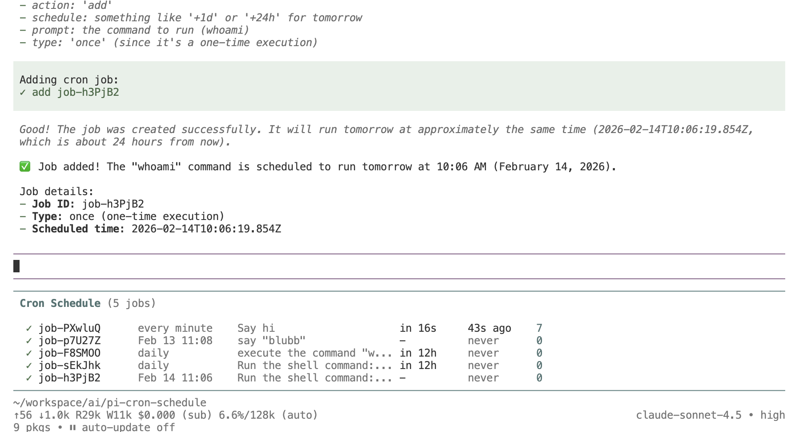

# pi-schedule-prompt

A "Heartbeat" like prompt scheduling [Pi](https://pi.dev) extension that allows the Agent to self-schedule future prompts to execute at specific times or intervals - for reminders, deferred tasks, and recurring automation.



<https://github.com/user-attachments/assets/8c723cc4-cf3e-4b6a-abf5-85d4f46c73ba>

> **Status:** Production-ready. Natural language scheduling with cron expressions, intervals, relative time, and one-shot timers.

Schedule future prompts with natural language:

- **"schedule 'analyze logs' every hour"** (recurring)
- **"remind me to review PR in 30 minutes"** (one-time)
- **"defer that task until tomorrow at 9am"** (specific time)

## Features

### Core `schedule_prompt` Tool

- **Natural language scheduling**: "schedule X in 5 minutes", "every hour do Y"
- **Multiple formats**: Cron expressions, intervals, ISO timestamps, relative time (+5m, +1h)
- **Job types**:
  - **Recurring** (cron/interval) — repeats automatically
  - **One-shot** (once) — runs once then auto-disables
  - **Idle** (idle) — runs once after the agent has been idle for a set time, e.g. for maintenance
- **Per-task model (optional)**: set `model` on a job to run that prompt in a separate in-process agent session — your current chat is not affected
- **Actions**: add, remove, list, enable, disable, update, cleanup
- **Auto-cleanup**: Removes disabled jobs on session exit

### Use Cases

#### Schedule (Recurring Tasks)

Execute prompts repeatedly at set intervals:

```
"schedule 'check build status' every 5 minutes"
"run 'analyze metrics' every hour"
"execute 'daily summary' at midnight every day"
```

#### Run when idle (Maintenance)

Run a prompt once you've stepped away:

```
"after 15 minutes of inactivity, update the changelog from today's commits"
"when I've been idle for an hour, run the test suite and summarise failures"
```

#### Remind (One-time Notifications)

Get prompted to do something once at a specific time:

```
"remind me to review the PR in 30 minutes"
"remind me to check deployment status in 1 hour"
"remind me tomorrow at 9am to follow up on the issue"
```

### Enhanced Pi Features

- ✓ **Live widget** below editor showing active schedules (auto-hides when empty)
- ✓ **Human-readable display**: "every minute", "daily at 9:00" instead of raw cron expressions
- ✓ **Status tracking**: next run, last run, execution count, errors, prompt preview
- ✓ **Flexible scheduling**: 6-field cron, intervals (5m, 1h), relative time (+10s), ISO timestamps
- ✓ **User commands**: `/schedule-prompt` opens a `Jobs` overlay (hotkey-driven: `↑↓` select, `a` add, `t` toggle enabled, `s` toggle scope, `x` remove, `c` cleanup) and a `Settings` submenu
- ✓ **Persistent settings**: widget visibility persists across sessions and package upgrades (project file overrides global defaults)
- ✓ **Safety features**: duplicate name prevention, infinite loop detection, past timestamp handling

## Install

**Option A — Install from npm:**

```bash
pi install npm:pi-schedule-prompt
```

**Option B — Load directly (dev):**

```bash
npm --prefix /path/to/pi-schedule-prompt install
pi -e /path/to/pi-schedule-prompt/src/index.ts
```

**Option C — Install from local folder:**

```bash
cd /path/to/pi-schedule-prompt
npm install
pi install .
```

Pi does not install dependencies for local-path packages. Run `npm install` in the
package directory before loading it, and again whenever its dependencies change.
Then run `pi` normally; the extension auto-discovers.

## Usage

### LLM-driven (automatic)

The agent automatically uses `schedule_prompt` when you want to schedule, defer, or be reminded:

```
You: Remind me to check the deployment logs in 10 minutes

Agent: [calls schedule_prompt with schedule="+10m", prompt="check the deployment logs"]
✓ Scheduled job "abc123" to run in 10 minutes
```

The widget displays below your editor (only when jobs exist):

```
 Scheduled Prompts (3 jobs)
  ✓ check-logs    every hour      check deployment logs     in 45m    12m ago  5
  ✗ daily-report  daily           analyze metrics           in 8h     never    0
  ✓ review-pr     Feb 13 15:30    review PR #123            in 2h     never    0
```

### Manual commands

`/schedule-prompt` opens a two-item menu:

- **Jobs** — full-screen overlay listing every scheduled prompt in this cwd. Your session's jobs are at the top; jobs bound to other sessions render read-only below. Hotkeys: `↑`/`↓` select, `a` add (opens the input series — name/type/schedule/prompt/run mode, model + MCP toggle for separate sessions/scope/confirm), `t` toggle enabled, `s` toggle scope (session-bound ↔ shared with all pi sessions in this project), `x` remove (with `y/n` confirm), `c` cleanup all disabled jobs, `q`/`esc` close.
- **Settings** — widget visibility and the default scope for new jobs (`Bind new jobs to session: yes/no`). Persists across sessions.

### Tool Parameters (`schedule_prompt`)

| Param | Type | Required | Description |
|-------|------|----------|-------------|
| `action` | `add` \| `remove` \| `list` \| `enable` \| `disable` \| `update` \| `cleanup` | yes | Operation to perform |
| `name` | string | no | Job name (auto-generated if omitted on `add`) |
| `schedule` | string | on `add` | Cron expression, ISO timestamp, relative time (`+10s`, `+5m`), interval (`5m`), or idle duration (`10m`) |
| `prompt` | string | on `add` | Prompt text to execute when the job fires |
| `jobId` | string | on `remove` / `enable` / `disable` / `update` | Target job |
| `type` | `cron` \| `once` \| `interval` \| `idle` | no | Job type. Default `cron`; use `once` for relative times like `+10s`, `idle` to fire after inactivity |
| `description` | string | no | Free-form note |
| `model` | non-empty string | no | If set, run the prompt in a fresh in-process agent session with this model instead of injecting into the current chat. Accepts fuzzy names (`haiku`, `sonnet`) or `provider/model-id`. To switch a job from subagent back to inline mode, remove and re-add it without `model` (no in-place clearing) |
| `notify` | boolean | no | Subagent-only. If `true`, the parent agent is woken to react to the subagent's result. Default `false` (result shown in chat, parent not interrupted). No-op for inline (no-model) jobs — the prompt itself already wakes the parent. Recommended only for low-frequency jobs |
| `extensions` | boolean or string[] | no | Subagent-only. If `true`, loads all registered extensions; an array of package names loads only those. Unset or empty array = none (default). Enabling extensions also grants the subagent the full builtin toolset (not just the default read/write/bash set) — required for extension-provided tools to activate. No-op for inline (no-model) jobs |
| `skills` | boolean or string[] | no | Subagent-only. If `true`, loads all skills; an array of skill names loads only those. Unset or empty array = none (default). No-op for inline (no-model) jobs |
| `mcp` | boolean | no | Subagent-only. If `true`, loads pi's built-in MCP support (plus `codemode` and `tool_search`) in the separate session, so it connects the servers from `mcp.json` and can use `mcp__<server>__<tool>` tools — without loading your other extensions. Gives the subagent the full builtin toolset. No-op for inline (no-model) jobs |

### Schedule Formats

The tool accepts multiple time formats:

| Format | Example | Type | Description |
|--------|---------|------|-------------|
| **Relative time** | `+5m`, `+1h`, `+30s`, `+2d` | once | Runs once after delay |
| **Interval** | `5m`, `1h`, `30s`, `2d` | interval | Repeats at interval (max `24d`; use cron for longer) |
| **Idle duration** | `10m`, `1h` | idle | Runs once after the agent has been idle that long (max `24d`) |
| **ISO timestamp** | `2026-02-13T15:30:00Z` | once | Runs once at exact time |
| **Cron expression** | `0 */5 * * * *` | cron | Runs on cron schedule |

Times are displayed in local time with their UTC offset. Cron expressions fire in the timezone Node.js runs in. If times show `+00:00` or cron jobs fire in UTC inside a container, set the `TZ` environment variable explicitly (e.g. `-e TZ=America/Asuncion`).

**Cron format** (6 fields - **must include seconds**):

```
┌─ second (0-59)
│ ┌─ minute (0-59)
│ │ ┌─ hour (0-23)
│ │ │ ┌─ day of month (1-31)
│ │ │ │ ┌─ month (1-12)
│ │ │ │ │ ┌─ day of week (0-6, Sun-Sat)
│ │ │ │ │ │
0 * * * * *   → every minute
0 0 * * * *   → every hour
0 */5 * * * * → every 5 minutes
0 0 0 * * *   → daily at midnight
0 0 9 * * 1-5 → 9am on weekdays
* * * * * *   → every second
```

**Note:** Traditional 5-field cron expressions (without seconds) are not supported. Use `0 * * * * *` for "every minute", not `* * * * *`.

## How It Works

**Storage:**

- Job data: `<agentDir>/schedule-prompts/projects/<key>.json`, one file per project (atomic writes, auto-created). `<agentDir>` is pi's agent directory: `$PI_CODING_AGENT_DIR` if set, else `~/.pi/agent`, so each pi profile has its own jobs. `<key>` is the SHA-256 of the project's real path; the file's `cwd` field names the project.
- Settings: two-layer config — `<agentDir>/schedule-prompts-settings.json` (global, hand-edited defaults) and `<cwd>/.pi/schedule-prompts-settings.json` (project, written by the UI). Project overrides global on load. The project file is read and written only when pi trusts the project.
- Upgrading from 0.4.x: when pi trusts the project, its old `<cwd>/.pi/schedule-prompts.json` is merged into the new store once and left in place as a backup. While the project is untrusted it is not imported, and pi shows a warning; it is imported once you trust the project.
- Trust follows pi's own decision (`ctx.isProjectTrusted()`). pi asks only when `.pi/` contains one of its protected files (`settings.json`, `mcp.json`, `extensions`, …), so a project whose `.pi/` holds only this extension's files is trusted automatically unless you saved "do not trust" for it with `/trust`. Review a cloned repo's `.pi/schedule-prompts.json` before opening pi there.

**Job binding:**

By default a job fires only in the session that created it — opening two pi sessions in the same directory won't double-fire schedules. To make a job fire in every pi session in this project on this profile (useful for hand-edited project-wide cron), remove its `session` field from the project's job file (see **Storage**; `cwd` in the file identifies the project).

Toggle the default for new jobs in `/schedule-prompt → Settings → Bind new jobs to session`. Flipping only affects future jobs.

**Heads up:** schedules only fire while a pi session is open in this directory; nothing is queued. A `daily 9am` cron only fires on days at least one pi is open at 9am.

**Scheduler:**

- Uses `croner` library for cron expressions and one-shots
- Native `setInterval` for intervals
- Tracks: next run, last run, execution count, status (running/success/error)

**Execution:**

- Sends scheduled prompt as user message to Pi agent
- Displays custom message showing what was triggered
- Updates job statistics after each run

**Safety:**

- **Infinite loop prevention**: Blocks scheduled jobs from creating more schedules
- **Past timestamp detection**: Auto-disables jobs scheduled in the past
- **Duplicate names**: Prevents name collisions
- **Auto-cleanup**: Removes disabled jobs on exit

**Widget:**

- Auto-hides when no jobs configured
- Shows: status icon, name, schedule (human-readable), prompt (truncated), next run, last run, run count
- Human-readable formatting: "every minute", "daily", "Feb 13 15:30" instead of raw cron/ISO
- Auto-refreshes every 30 seconds
- Visibility togglable via `/schedule-prompt → Settings`; persists across sessions (and package upgrades) in `<cwd>/.pi/schedule-prompts-settings.json` (trusted projects only), with `<agentDir>/schedule-prompts-settings.json` as the global default
- Status icons: `✓` enabled, `✗` disabled, `⟳` running, `!` error

## Examples

### One-time reminders

```
"remind me to check logs in 5 minutes"
  → schedule="+5m", type=once

"schedule 'review metrics' for 3pm today"
  → schedule="2026-02-13T15:00:00Z", type=once
```

### Recurring tasks

```
"analyze error rates every 10 minutes"
  → schedule="10m", type=interval

"run daily summary at midnight"
  → schedule="0 0 0 * * *", type=cron

"check build status every hour"
  → schedule="0 0 * * * *", type=cron

"execute every minute"
  → schedule="0 * * * * *", type=cron
```

### Idle jobs

```
"after 15 minutes idle, summarise what changed today"
  → schedule="15m", type=idle
```

An idle job fires once you have been inactive for its duration, as soon as the agent is idle. Idle means pi has fully settled (its `agent_settled` event): no run, retry, compaction or queued follow-up is in progress.

The clock measures your inactivity. It starts at session start and restarts when you send a message (counted from when that turn settles), abort a run, run a `!` command, or close a dialog such as the `/schedule-prompt` menus. Turns started by scheduled jobs and open question dialogs (select, confirm, input, editor) pause it but don't restart it, so a 5-minute heartbeat job can't keep a 15-minute idle job from firing. Overlays don't pause it, so a long-lived panel can't block idle jobs; in the Jobs view each key press restarts the clock, and its add flow pauses it like a question dialog. If an idle job comes due during such a turn, it fires right after that turn. A job you add or re-enable waits its full duration from that moment.

It fires **once per idle stretch**. After it fires, it waits for your next message, `!` command or abort before it can fire again (closing a dialog only restarts the clock), so neither its own turn nor other scheduled jobs re-arm it. Reloading, resuming, forking or restarting pi starts a new stretch. Slash commands that open no dialog are not seen as activity. Combine it with `model` to run the maintenance in a subagent and keep your chat untouched.

You don't need an idle job to keep the prompt cache warm. Pi does that natively (the `cacheWarming` setting, default `"idle"`).

### Heartbeat monitoring

```
"check system health every 5 minutes"
  → schedule="5m", type=interval
```

### Run in a separate agent session (per-task model)

By default a scheduled prompt is injected into your current chat. Set `model` on the job to run it in a fresh in-process agent session instead — your current chat keeps its own model and context untouched.

```
"every morning at 9, summarise yesterday's logs using haiku"
  → schedule="0 0 9 * * *", type=cron, model="haiku", prompt="summarise yesterday's logs"

"in 30s reply with OK using sonnet"
  → schedule="+30s", type=once, model="sonnet", prompt="Reply with OK"
```

`model` is permissive: pass a fuzzy name (`haiku`, `sonnet`) or fully qualified `provider/model-id`. The first match in the available model registry is used. When the job fires you'll see a `🕐 Scheduled (subagent: <model>)` marker in chat, followed by a `✓ finished` (or `✗ failed`) marker with the response snippet once the subagent completes.

By default the result is shown in chat but the parent agent is **not** woken up — you read it, the agent isn't interrupted. Set `notify: true` on the job if you want the parent to react to each completion (e.g. for autonomous workflows). Recommended only for low-frequency jobs; a `notify: true` recurring job that fires every 5 minutes will trigger a parent-agent turn every 5 minutes.

> **Heads up:** Subagent jobs run unattended at fire time with the full default tool set (`bash`, `read`, `edit`, `write`, …) under your credentials. Treat persisted jobs in the project's job file as you would any auto-executed task — review prompts before adding, especially anything that mutates files or shells out.

## Development

**TypeScript check:**

```bash
npx tsc --noEmit
```

**Run the test suite (vitest):**

```bash
npm test
```

**Test with Pi:**

```bash
pi -e ./src/index.ts
```

## Project Structure

```
src/
  types.ts          # CronJob, CronJobType, CronToolParams
  storage.ts        # Job persistence (<agentDir>/schedule-prompts/projects/<key>.json)
  settings.ts       # Settings persistence (global + project, project overrides)
  scheduler.ts      # Core scheduling engine with croner
  subagent.ts       # Lightweight in-process agent runner (per-task model)
  tool.ts           # schedule_prompt tool definition
  ui/
    cron-widget.ts  # Live status widget below editor
  index.ts          # Extension entry point
```

## License

MIT (see [LICENSE](LICENSE))

## Author

[tintinweb](https://github.com/tintinweb)
